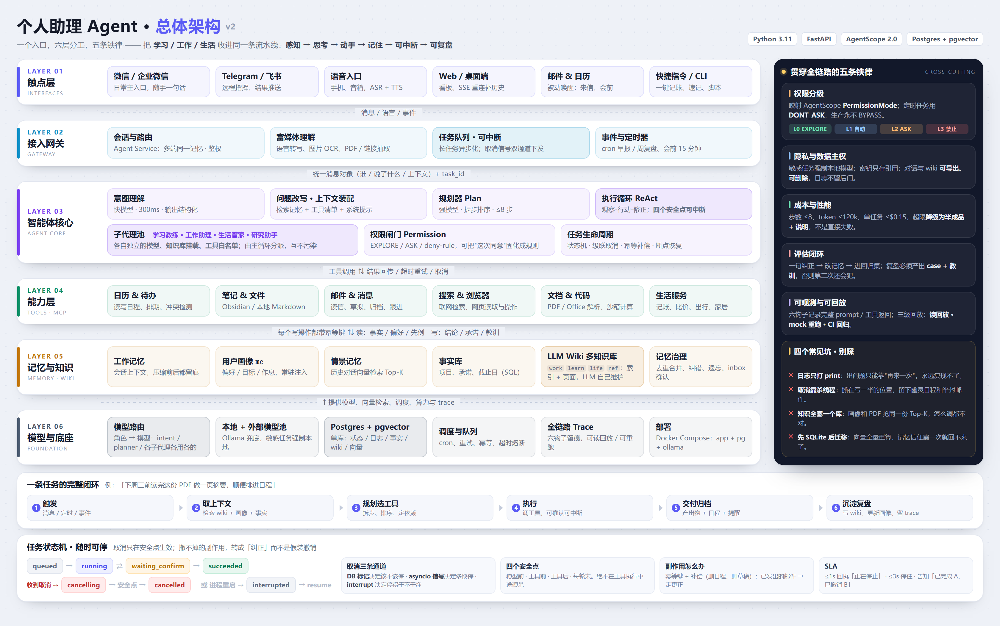

# AssistantAgent

> 个人助理 Agent —— 学习 / 工作 / 生活，**一个入口，六层分工，五条铁律**。



---

## 现在能跑什么

骨架的目标不是"功能多"，而是**三条最容易做坏的主干先立住**：

| 能力 | 状态 | 在哪 |
|---|---|---|
| FastAPI 服务 + 任务异步化 | ✅ 可用 | `app/api/routes.py` |
| 任务状态机（穷举迁移） | ✅ 可用 | `app/core/tasks.py` |
| **取消三通道 + 四个安全点** | ✅ 可用 | `app/core/cancel.py` |
| 副作用补偿（幂等键） | ✅ 可用 | `app/core/cancel.py`、`app/agent/tools.py` |
| 全链路 trace（含落库） | ✅ 可用 | `app/core/trace.py`、`app/db/trace_sink.py` |
| 角色化模型路由 + 敏感强制本地 | ✅ 可用 | `app/agent/routing.py`、`config/models.yaml` |
| Postgres schema（含 pgvector） | ✅ 可用 | `app/db/schema.sql` |
| 离线评测（案例/跑批/计分卡） | ✅ 可用 | `eval/` |
| **AgentScope 接入** | ⚠️ EXPERIMENTAL | `app/agent/factory.py` |
| LLM Wiki 多库、pgvector VectorStore | 🚧 待实现 | 见路线图 |

> 说明：AgentScope 2.x 的构造参数仍在演进，`AgentScopeRuntime` 里按你锁定的版本校准一遍再上生产。
> 除此之外的代码都有测试覆盖，`python -m unittest discover -s tests` 31 条全绿。

---

## 30 秒跑起来

不需要数据库，不需要模型 —— 用 `echo` 运行时就能把「提交 → 执行 → 取消 → 留痕」整条链路走一遍：

```bash
pip install -e .

# 可选：没有 .env 也能跑，默认内存模式
uvicorn app.main:app --reload
```

打开 <http://127.0.0.1:8000/docs>，或直接试：

```bash
# 1) 提一个任务（立刻返回 task_id，不等模型）
curl -X POST localhost:8000/api/chat \
  -H "Content-Type: application/json" \
  -d '{"message":"记一下：周四前把季度数据发给财务"}'
# → {"task_id":"...","state":"queued", ...}

# 2) 查结果
curl localhost:8000/api/tasks/<task_id>

# 3) 随时喊停（在下一个安全点生效，不是硬杀）
curl -X POST localhost:8000/api/tasks/<task_id>/cancel \
  -H "Content-Type: application/json" -d '{"reason":"不做了"}'
# → {"state":"cancelling","message":"已受理取消，将在下一个安全点停止"}

# 4) 复盘：这条任务到底发生了什么
curl localhost:8000/api/tasks/<task_id>/trace
```

### 带数据库

```bash
docker compose up -d db          # pgvector/pgvector:pg16，首次启动自动执行 schema.sql
cp .env.example .env             # 默认已指向 localhost:5432
uvicorn app.main:app --reload    # /health 里 db 会变成 up
```

> 手工初始化：`psql $DATABASE_URL -f app/db/schema.sql`
> schema 里的 `halfvec` 需要 pgvector ≥ 0.7；老版本把 `halfvec(1024)` 改成 `vector(1024)`。

### 接 AgentScope

```bash
pip install -e ".[agent]"
export AGENT_BACKEND=agentscope    # Windows: $env:AGENT_BACKEND="agentscope"
# 再按 config/models.yaml 配好 Ollama 或 API Key
```

`AGENT_BACKEND` 三档：`auto`（有就用，没有退 echo）/ `agentscope` / `echo`。

---

## 目录

```
app/
├── main.py              # 入口：任何一环挂掉都能起（DB 挂→内存，模型坏→echo）
├── config.py            # 环境变量 / .env
├── api/routes.py        # /health /api/chat /api/tasks/{id} [/cancel|/trace]
├── core/
│   ├── tasks.py         # 状态机：穷举所有合法迁移
│   ├── cancel.py        # 取消三通道 + 四个安全点 + 补偿
│   ├── runner.py        # 中枢：提交 → 执行 → 取消 → 落状态
│   └── trace.py         # 全链路事件
├── agent/
│   ├── routing.py       # 角色 → 模型，敏感强制本地，降级链
│   ├── factory.py       # echo / agentscope 两种运行时
│   └── tools.py         # 工具契约：副作用等级 + 幂等键 + 权限
└── db/
    ├── schema.sql       # Postgres 16 + pgvector
    ├── pool.py          # 连不上就降级，不阻塞启动
    ├── repo.py          # 内存 / Postgres 两套实现，乐观锁
    └── trace_sink.py    # trace 落库（失败不拖垮主流程）

config/models.yaml       # 角色 → 模型（进版本库、可 review）
eval/                    # 离线评测：cases / fixtures / runner / score
docs/                    # 架构说明、评测方案、架构图
tests/                   # 31 条 unittest
```

---

## 设计上的三个决定

### 1. `POST /api/chat` 立刻返回，不等着跑完

**只有异步化才可能取消。** 同步接口里，用户点"停"的那一瞬间，手上根本没有东西可停。

代价是客户端要轮询 `GET /api/tasks/{id}`（后续可换 SSE）。这个代价必须付。

### 2. 状态机单独成文件，且穷举所有迁移

个人助理的事故大多不是"算错"，是**状态说不清**：界面显示已取消，后台还在跑；或者已经发了邮件，状态还是 running。

所以 `ALLOWED` 表把迁移写死，`cancelling` / `interrupted` 两个中间态必须存在：
- 没有 `cancelling`，就分不清"要停"和"已停"
- 没有 `interrupted`，进程重启后只能算失败，其实可以 `resume`

### 3. 数据库连不上也要能启动

新人 `git clone` 之后第一件事是 `uvicorn`，不是装 Postgres。
所以 `Database.connect()` 失败 → 内存仓储；`ModelRouter` 报错 → echo 运行时。
**骨架的第一体验不该是"跑不起来"。**

---

## 测试

```bash
python -m unittest discover -s tests -v
```

31 条，覆盖：状态机穷举 / 非法迁移 / 四个安全点 / 补偿逆序 / 失败补偿留证 /
父子级联取消 / 真实任务中途取消 / 取消已结束任务返回冲突 / 路由敏感降级 / HTTP 全链路。

不需要数据库、不需要模型、不需要网络。

---

## 评测

```bash
python eval/runner.py --agent scripted --out eval/report/demo
python eval/score.py  --run eval/report/demo/run.json
cat eval/report/demo/report.md
```

示例 case 里故意留了一次**越权发邮件**，所以你会看到 `BLOCK` —— 那是设计出来的：
安全项一票否决，一个 case 直接清零。细节见 `docs/eval-plan.md`。

---

## 路线图

- [ ] **记忆层**：LLM Wiki 多库（me/work/learn/life/ref）+ 索引与页面维护任务
- [ ] **pgvector VectorStore**：实现 AgentScope `VectorStoreBase`，接 `KnowledgeBase` handle
- [ ] **HITL 全链路**：`waiting_confirm` → 确认/拒绝接口 → 权限规则固化
- [ ] **SSE 事件流**：替代轮询，断线可补历史
- [ ] **AgentScope 接入校准**：按锁定版本对齐模型构造与工具注册
- [ ] **影子模式**：写工具 dry-run，只记录不执行

---

## 相关文档

- [架构说明](docs/architecture.md) —— 六层职责、取消逻辑、模型路由、日志与回放
- [评测方案](docs/eval-plan.md) —— 五层指标、三条铁律、计分卡与门禁
